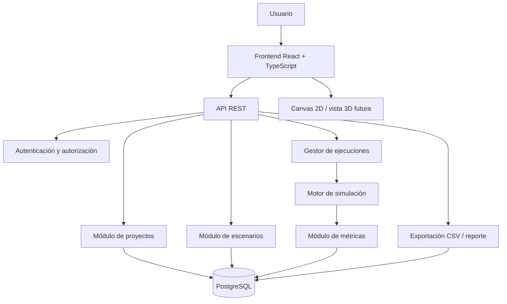

# SimuCity Lab
## Documento de visión, diseño funcional, simulación, arquitectura y seguridad

**Versión:** 1.0  
**Fecha:** octubre de 2026  
**Estado:** propuesta inicial  
**Tipo de producto:** simulador urbano web interactivo  
**IA generativa:** no necesaria para el MVP

---

## Índice

1. [Resumen ejecutivo](#1-resumen-ejecutivo)
2. [Idea principal y propuesta de valor](#2-idea-principal-y-propuesta-de-valor)
3. [Usuarios, objetivos y alcance](#3-usuarios-objetivos-y-alcance)
4. [Requisitos funcionales](#4-requisitos-funcionales)
5. [Experiencia de usuario](#5-experiencia-de-usuario)
6. [Fundamentos matemáticos](#6-fundamentos-matemáticos)
7. [Motor de simulación](#7-motor-de-simulación)
8. [Rutas, intersecciones y semáforos](#8-rutas-intersecciones-y-semáforos)
9. [Métricas y comparación](#9-métricas-y-comparación)
10. [Arquitectura del sistema](#10-arquitectura-del-sistema)
11. [Tecnologías recomendadas](#11-tecnologías-recomendadas)
12. [Modelo de datos](#12-modelo-de-datos)
13. [API propuesta](#13-api-propuesta)
14. [Seguridad y privacidad](#14-seguridad-y-privacidad)
15. [Rendimiento y escalabilidad](#15-rendimiento-y-escalabilidad)
16. [Pruebas y validación](#16-pruebas-y-validación)
17. [Plan de desarrollo](#17-plan-de-desarrollo)
18. [Modelo de negocio y costos](#18-modelo-de-negocio-y-costos)
19. [Riesgos y mitigaciones](#19-riesgos-y-mitigaciones)
20. [Evolución futura](#20-evolución-futura)
21. [Criterios de aceptación](#21-criterios-de-aceptación)
22. [Glosario](#22-glosario)
23. [Referencias técnicas](#23-referencias-técnicas)

---

# 1. Resumen ejecutivo

**SimuCity Lab** es una plataforma web que permite construir una representación simplificada de una zona urbana y experimentar con cambios en su infraestructura y operación. El usuario puede modificar calles, intersecciones, carriles, sentidos de circulación, semáforos, cierres de vías y demanda de vehículos; luego ejecuta una simulación y compara los resultados.

La plataforma convierte preguntas como estas en experimentos configurables:

- ¿Qué ocurre si una calle queda cerrada?
- ¿Cómo cambia la cola si modifico el tiempo de un semáforo?
- ¿Qué intersecciones se convierten en cuellos de botella cuando aumenta la demanda?
- ¿Qué alternativa distribuye mejor los vehículos?
- ¿Cómo cambia el tiempo de viaje entre dos escenarios?

El sistema muestra vehículos o flujos sobre una red visual y calcula indicadores como tiempo de viaje, tiempo de espera, longitud de colas y vehículos que completan sus recorridos.

**Importante:** el MVP será un simulador educativo y de exploración, no una herramienta certificada para diseñar infraestructura vial. Los resultados dependerán de los datos y de las simplificaciones del modelo.

### Propuesta de valor

> Prueba cambios en una ciudad virtual, compara escenarios y comprende cómo pueden afectar la congestión antes de intervenir en una vía real.

### Decisión tecnológica central

No se necesita IA generativa ni una API comercial de IA para el funcionamiento principal. El valor se basa en simulación, algoritmos de grafos, reglas explícitas y visualización. Esto evita el costo variable de tokens, aunque pueden existir gastos de servidor, almacenamiento, dominio y mapas si se integran.

---

# 2. Idea principal y propuesta de valor

## 2.1 Concepto

El usuario diseña una red vial mediante un editor visual. Internamente, la red se convierte en un grafo dirigido. Luego configura demanda, semáforos y duración de la ejecución. El motor calcula la evolución de la red y produce métricas.

El usuario puede duplicar el escenario, modificar algunos parámetros y comparar ambos resultados.

## 2.2 Diferenciación

SimuCity Lab no debe limitarse a mostrar coches animados. Su principal diferencial es permitir **formular una hipótesis, ejecutar un experimento reproducible y explicar por qué cambió un resultado**.

Características diferenciadoras:

1. Comparación de escenarios lado a lado.
2. Semillas aleatorias reproducibles para comparaciones justas.
3. Visualización de colas y cuellos de botella.
4. Historial de parámetros y resultados.
5. Explicación de los supuestos utilizados.
6. Exportación de métricas y gráficos.
7. Plantillas editables para aprender con ejemplos.
8. Posibilidad de importar redes autorizadas en una etapa posterior.

## 2.3 Principio fundamental

El motor de simulación es la fuente de verdad. La animación únicamente representa el estado calculado. El resultado no debe depender de la velocidad de renderizado del navegador.

---

# 3. Usuarios, objetivos y alcance

## 3.1 Usuarios iniciales

- Estudiantes y docentes de informática, ingeniería, transporte y urbanismo.
- Universidades y centros de investigación.
- Consultoras de movilidad que necesiten demostraciones preliminares.
- Equipos de innovación municipal.
- Educadores y divulgadores científicos.

Se recomienda empezar con el mercado educativo y redes sintéticas. Es más sencillo validar el producto allí que venderlo desde el inicio como herramienta para decisiones de infraestructura pública.

## 3.2 Objetivo general

Desarrollar una aplicación web interactiva que permita modelar una red vial simplificada, ejecutar simulaciones reproducibles y comparar escenarios con métricas comprensibles.

## 3.3 Objetivos específicos

- Crear y editar nodos, calles, carriles e intersecciones.
- Configurar semáforos y reglas de movimiento.
- Definir demanda de vehículos por entrada y destino.
- Ejecutar simulaciones con parámetros y semilla registrados.
- Visualizar el estado de la red durante o después de una ejecución.
- Calcular métricas agregadas y por segmento.
- Guardar, duplicar y versionar escenarios.
- Exportar datos e informes.
- Separar la lógica de simulación de la presentación visual.

## 3.4 Alcance del MVP

- Registro e inicio de sesión.
- Editor de red vial 2D.
- Nodos y segmentos dirigidos.
- Propiedades básicas de cada calle.
- Semáforos con fases sencillas.
- Demanda de vehículos configurable.
- Motor de flujo y colas.
- Animación básica.
- Métricas de viaje, espera, cola y flujo completado.
- Guardado y duplicación de escenarios.
- Comparación de dos ejecuciones.
- Exportación CSV e informe básico.

## 3.5 Fuera del alcance inicial

- Control de semáforos reales.
- Predicción garantizada del tráfico real.
- Modelado completo de peatones, bicicletas y transporte público.
- Integración obligatoria con cámaras, GPS o sensores.
- Gemelo digital validado de una ciudad completa.
- Recomendaciones oficiales de obras.
- IA generativa como requisito.

---

# 4. Requisitos funcionales

## 4.1 Funcionales

1. Crear, editar, duplicar y eliminar proyectos propios.
2. Añadir, editar y eliminar nodos y segmentos.
3. Validar conexiones y sentidos de circulación.
4. Configurar velocidad, carriles y capacidad aproximada.
5. Crear planes semafóricos compatibles con movimientos permitidos.
6. Definir entradas, destinos y demanda de vehículos.
7. Configurar duración, paso temporal y semilla.
8. Iniciar, pausar, reanudar y finalizar una ejecución cuando el modo lo permita.
9. Mostrar estado, progreso y métricas.
10. Guardar parámetros y versión del motor de cada ejecución.
11. Comparar escenarios bajo condiciones equivalentes.
12. Exportar métricas y parámetros.
13. Advertir si la red está desconectada o el escenario es inválido.

## 4.2 No funcionales

- **Usabilidad:** acciones principales comprensibles sin formación especializada.
- **Reproducibilidad:** una ejecución puede repetirse con la misma configuración, semilla y versión del motor.
- **Rendimiento:** el editor sigue siendo usable durante simulaciones moderadas.
- **Seguridad:** los usuarios solo acceden a los recursos autorizados.
- **Mantenibilidad:** el motor se prueba sin navegador ni base de datos.
- **Portabilidad:** desarrollo local y despliegue reproducible.
- **Observabilidad:** errores y tiempos de ejecución registrados sin exponer secretos.

---

# 5. Experiencia de usuario

## 5.1 Pantallas

1. **Inicio / proyectos:** proyectos recientes y botón para crear uno nuevo.
2. **Editor de ciudad:** lienzo, herramientas para nodos y calles, panel de propiedades.
3. **Configuración:** demanda, duración, semilla y parámetros.
4. **Ejecución:** animación, estado y controles de reproducción.
5. **Resultados:** gráficos, tablas e indicadores.
6. **Comparador:** escenario A frente a escenario B.
7. **Configuración del proyecto:** nombre, descripción, permisos y exportación.

## 5.2 Flujo principal

1. Crear un proyecto.
2. Dibujar una red o seleccionar una plantilla.
3. Configurar calles e intersecciones.
4. Configurar semáforos y demanda.
5. Validar el escenario.
6. Ejecutar la simulación.
7. Revisar las métricas.
8. Duplicar el escenario.
9. Cambiar uno o más parámetros.
10. Ejecutar con condiciones equivalentes.
11. Comparar y exportar resultados.

## 5.3 Principios de interfaz

- Mostrar las unidades de cada parámetro.
- Diferenciar valores editables y métricas calculadas.
- Mostrar supuestos y limitaciones.
- Permitir pausar la reproducción sin alterar los resultados calculados.
- Resaltar qué parámetros cambiaron entre escenarios.
- Explicar cada indicador en lenguaje sencillo.

---

# 6. Fundamentos matemáticos

## 6.1 Red vial como grafo dirigido

La ciudad se representa como un grafo dirigido:

\[
G = (V, E)
\]

- **V (vértices):** intersecciones, entradas, salidas y puntos de conexión.
- **E (aristas):** segmentos dirigidos que conectan los vértices.

Cada segmento puede tener longitud, número de carriles, velocidad máxima, capacidad, estado abierto/cerrado, sentido y restricciones de giro. Los sentidos opuestos se representan como aristas diferentes.

## 6.2 Geometría

En el MVP, los nodos pueden tener coordenadas `x` e `y` en un plano del editor. Estas coordenadas visuales no deben confundirse con coordenadas geográficas reales.

Si se importan redes geográficas, se necesita una proyección o transformación consistente para calcular distancias. No se deben interpretar directamente grados de latitud/longitud como metros.

## 6.3 Dos niveles de fidelidad

### Modelo macroscópico: flujo y colas

Representa la cantidad de vehículos o el flujo que pasa por segmentos y cruces durante cada intervalo. Es más simple, rápido y fácil de validar. **Es la opción recomendada para el MVP.**

### Modelo microscópico: vehículos individuales

Cada vehículo posee posición y velocidad. Se aplican reglas de seguimiento, frenado, avance e ingreso a intersecciones. La animación es más rica, pero aumenta la complejidad y requiere calibración.

La arquitectura debe permitir evolucionar del modelo de flujo y colas hacia el movimiento individual sin reescribir toda la aplicación.

## 6.4 Variables del modelo

**Entradas:**
- Tasa de llegada de vehículos.
- Distribución de destinos.
- Longitud y capacidad de segmentos.
- Velocidad de referencia.
- Plan semafórico.
- Duración y paso temporal.
- Semilla aleatoria.
- Cierres de vías.

**Estado:**
- Vehículos o cantidad de vehículos por segmento.
- Cola por movimiento o aproximación.
- Fase actual de semáforos.
- Tiempo simulado.
- Viajes completados e incompletos.

**Salidas:**
- Tiempo de viaje.
- Tiempo de espera.
- Longitud de cola.
- Flujo completado.
- Utilización aproximada.
- Segmentos congestionados.
- Viajes que no concluyeron antes del final.

## 6.5 Llegada de vehículos

La demanda se configura como vehículos por minuto. Se pueden ofrecer tres modos:

- **Periódico:** llega un vehículo a intervalos fijos.
- **Aleatorio reproducible:** llegadas generadas con un generador pseudoaleatorio y una semilla.
- **Perfil por periodos:** demanda baja, media o alta en intervalos configurados.

Una distribución de Poisson puede modelar llegadas aleatorias con una tasa media, pero supone llegadas independientes y no representa todos los patrones reales de tráfico.

## 6.6 Tiempo discreto

El motor avanza en pasos de tiempo \(\Delta t\). Se puede empezar probando con 0,5 segundos simulados y ajustar el valor mediante pruebas.

Cada paso debe seguir un orden definido: actualizar semáforos, generar llegadas, calcular movimientos candidatos, resolver capacidad, aplicar movimientos y actualizar métricas. Se debe evitar que el orden de iteración favorezca sistemáticamente a ciertos vehículos o segmentos.

El paso temporal no tiene que coincidir con el tiempo real del reloj.

---

# 7. Motor de simulación

## 7.1 Responsabilidad

El motor recibe una red validada, parámetros, demanda y semilla. Devuelve estados o eventos de la ejecución y un resumen de resultados.

Debe ser independiente de React, del DOM y del renderizado 2D/3D. Así puede probarse desde pruebas automatizadas y ejecutarse en un proceso backend.

## 7.2 Ciclo de ejecución

```text
inicializar escenario
validar grafo y parámetros
inicializar generador pseudoaleatorio
crear estado de segmentos, colas y semáforos
mientras el tiempo simulado sea menor que la duración:
    actualizar fases semafóricas
    generar llegadas
    calcular movimientos candidatos
    comprobar capacidad y restricciones
    aplicar movimientos de forma consistente
    actualizar tiempos, colas y métricas
    guardar muestras según la frecuencia configurada
finalizar viajes y métricas pendientes
guardar resumen, parámetros y versión del motor
```

## 7.3 Reproducibilidad

Cada ejecución debe guardar:

- Versión del motor.
- Versión del esquema del escenario.
- Parámetros completos.
- Semilla pseudoaleatoria.
- Configuración de demanda y semáforos.
- Duración y paso temporal.
- Estado final y métricas.

La misma configuración debe producir el mismo resultado lógico en modo determinista. Si se introduce paralelismo u otra fuente de no determinismo, la limitación debe documentarse.

## 7.4 Ejecución por lotes y en vivo

- **Por lotes:** se calcula toda la ejecución y luego se reproduce la animación.
- **En vivo:** el motor calcula y comunica actualizaciones a medida que avanza.

Se recomienda empezar por lotes o bloques cortos. La reproducción puede acelerarse o ralentizarse sin alterar los resultados calculados.

## 7.5 Detección de anomalías

El motor debe identificar redes desconectadas, destinos inaccesibles, parámetros inválidos y vehículos que permanecen inmóviles demasiado tiempo. Una cola persistente puede ser un resultado válido del escenario, no necesariamente un error. La interfaz debe distinguir ambos casos.

---

# 8. Rutas, intersecciones y semáforos

## 8.1 Rutas

### Dijkstra
Encuentra una ruta de menor costo en un grafo con pesos no negativos.

### A*
Utiliza una heurística para orientar la búsqueda hacia el destino. La heurística debe ser compatible con la función de costo y no sobreestimar el costo óptimo si se desea garantizar optimalidad.

### Función de costo

El costo inicial puede ser el tiempo estimado de recorrido:

\[
c_e = \frac{L_e}{v_e}
\]

Donde \(L_e\) es la longitud y \(v_e\) la velocidad en unidades compatibles. Posteriormente se puede añadir el tiempo de espera estimado.

La ruta más corta no siempre es la más rápida. La interfaz debe indicar qué función de costo se está optimizando.

## 8.2 Intersecciones

Una intersección define qué movimientos están permitidos desde una arista de entrada hacia una arista de salida. El MVP debe usar plantillas de movimientos compatibles para reducir configuraciones contradictorias.

Un vehículo puede avanzar si:
1. El movimiento existe.
2. El semáforo lo autoriza.
3. Hay capacidad en el segmento siguiente.
4. No se infringe una regla de ocupación o conflicto del modelo.

## 8.3 Semáforos

Cada controlador contiene:
- Fases.
- Duración por fase.
- Movimientos autorizados.
- Tiempo de transición, si se modela.
- Duración total del ciclo.

Los movimientos incompatibles no deben recibir autorización simultánea. Para el MVP conviene ofrecer plantillas de fases validadas en lugar de permitir combinaciones totalmente libres.

## 8.4 Capacidad y propagación de colas

Cada segmento tiene una capacidad de almacenamiento aproximada. Si se llena, puede impedir que los vehículos ingresen desde el segmento anterior. Este bloqueo debe modelarse explícitamente si se quiere representar propagación de colas.

Los valores por defecto son parámetros pedagógicos, no mediciones reales.

---

# 9. Métricas y comparación

## 9.1 Métricas principales

- **Tiempo medio de viaje:** tiempo promedio de viajes completados.
- **Tiempo de espera:** tiempo detenido o en cola según una definición fija.
- **Longitud de cola:** vehículos esperando o longitud espacial estimada.
- **Flujo completado:** vehículos que llegan al destino por intervalo o por ejecución.
- **Percentil 95 del viaje:** tiempo por debajo del cual se encuentran el 95 % de los viajes completados, si hay suficientes observaciones.
- **Saturación aproximada:** relación entre demanda y capacidad modelada.
- **Viajes incompletos:** vehículos que no alcanzaron su destino al finalizar.

Cada métrica debe indicar unidades, definición y cantidad de observaciones utilizadas.

## 9.2 Comparación justa

Mantener iguales, cuando sea posible:
- Demanda y destinos.
- Duración de la simulación.
- Semilla.
- Condiciones iniciales.
- Versión del motor.

Para comparar variabilidad, ejecutar varias semillas y presentar promedio y dispersión. No elegir únicamente la ejecución más favorable.

## 9.3 Variación porcentual

Para una métrica donde un valor menor es mejor:

\[
\text{Reducción porcentual} = \frac{A-B}{A}\times100
\]

Donde \(A\) es el escenario base y \(B\) el escenario nuevo. Un valor positivo representa una reducción. Si \(A=0\), no se debe dividir por cero; mostrar diferencia absoluta o “no aplicable”.

## 9.4 Visualizaciones

- Gráfico temporal de colas.
- Barras de tiempo de viaje por escenario.
- Mapa de calor de congestión estimada.
- Tabla de resultados por segmento.
- Distribución de tiempos de viaje.
- Viajes completados frente a incompletos.

---

# 10. Arquitectura del sistema

## 10.1 Enfoque

Se recomienda un **monolito modular** para el MVP. Es más simple de desarrollar y desplegar que una arquitectura de microservicios, pero mantiene límites internos claros. El motor de simulación podrá separarse más adelante si el volumen lo requiere.

## 10.2 Diagrama lógico



## 10.3 Frontend

Responsabilidades:
- Editor de red.
- Formularios y validación.
- Controles de ejecución.
- Visualización de estados.
- Gráficos de resultados.
- Comparación de escenarios.
- Estados de carga y errores.

Tecnologías:
- React.
- TypeScript.
- Vite.
- React Flow o SVG/Canvas para editar el grafo.
- Canvas 2D o PixiJS para animar muchos vehículos.
- Three.js opcional para una futura vista 3D.
- Recharts u otra librería para gráficos.

React Flow facilita editar nodos y conexiones; Canvas/PixiJS puede resultar más eficiente para dibujar grandes cantidades de vehículos. No es obligatorio usar ambas herramientas desde el inicio.

## 10.4 Backend

Opción recomendada:
- Java + Spring Boot.
- API REST versionada.
- Validación de entrada.
- Autenticación y autorización.
- Persistencia de proyectos y resultados.
- Gestión de ejecuciones.
- Exportación de informes.

El motor puede implementarse inicialmente como un módulo Java independiente dentro del proyecto. Si el rendimiento lo exige, puede extraerse posteriormente a un worker.

## 10.5 Base de datos

PostgreSQL sirve para usuarios, proyectos, escenarios, ejecuciones y métricas agregadas. PostGIS no es necesario mientras el editor use coordenadas abstractas; se puede evaluar al incorporar datos geográficos reales.

## 10.6 Ejecuciones asíncronas

Una simulación larga no debe bloquear una petición HTTP. El backend crea un registro y procesa la ejecución como tarea.

Estados:
- `PENDING`
- `RUNNING`
- `COMPLETED`
- `FAILED`
- `CANCELLED`

En el MVP puede usarse un worker interno. Una cola de trabajos separada puede incorporarse cuando haya demanda real.

## 10.7 Módulos de dominio

- `Identity`: usuarios y sesiones.
- `Projects`: proyectos y permisos.
- `Network`: nodos, aristas y validaciones.
- `Scenarios`: demanda, parámetros y semáforos.
- `SimulationEngine`: ejecución del modelo.
- `Metrics`: cálculo y agregación.
- `Comparison`: comparación de ejecuciones.
- `Exports`: CSV e informes.
- `Audit`: operaciones y eventos de seguridad.

---

# 11. Tecnologías recomendadas

| Capa | Tecnología | Justificación |
|---|---|---|
| Frontend | React + TypeScript + Vite | Desarrollo modular y ecosistema amplio |
| Editor de grafo | React Flow o SVG/Canvas | Edición visual |
| Animación | Canvas 2D o PixiJS | Rendimiento con muchos objetos |
| Vista 3D futura | Three.js | Escena 3D interactiva |
| Backend | Java + Spring Boot | API y reglas de dominio |
| Base de datos | PostgreSQL | Persistencia relacional |
| Migraciones | Flyway o Liquibase | Versionado del esquema |
| Pruebas Java | JUnit | Pruebas unitarias |
| Pruebas frontend | Vitest + Testing Library | Pruebas de componentes |
| Pruebas E2E | Playwright | Pruebas de flujos completos |
| Despliegue | Docker | Entorno reproducible |
| Versionamiento | Git | Historial y colaboración |

No se recomienda añadir Kubernetes, microservicios, Kafka o múltiples bases de datos solo por usar tecnologías avanzadas. Cada componente debe responder a una necesidad medida.

---

# 12. Modelo de datos

Esquema conceptual, sujeto a normalización y revisión durante la implementación.

## 12.1 Entidades

### `users`
- `id`
- `email`
- `password_hash` o referencia a proveedor de identidad
- `created_at`
- `status`

### `projects`
- `id`
- `owner_id`
- `name`
- `description`
- `visibility`
- `created_at`
- `updated_at`

### `scenarios`
- `id`
- `project_id`
- `name`
- `schema_version`
- `network_snapshot`
- `demand_config`
- `signal_config`
- `created_at`
- `updated_at`

### `simulation_runs`
- `id`
- `scenario_id`
- `engine_version`
- `status`
- `seed`
- `time_step`
- `duration`
- `parameters_snapshot`
- `started_at`
- `finished_at`
- `error_code` opcional

### `simulation_metrics`
- `id`
- `run_id`
- `metric_name`
- `metric_value`
- `unit`
- `scope_type`
- `scope_id` opcional
- `time_bucket` opcional

### `scenario_versions`
Se puede incorporar para guardar cambios históricos, autor, fecha y resumen de modificaciones.

## 12.2 JSON frente a tablas normalizadas

- **JSON:** práctico para guardar un snapshot autocontenido del escenario.
- **Tablas normalizadas:** adecuadas para consultar y editar entidades individualmente.
- **Enfoque híbrido:** tablas para entidades principales y snapshot versionado para reproducir cada ejecución.

La recomendación es almacenar una instantánea inmutable de la configuración usada por cada simulación. Editar el escenario actual no debe modificar resultados anteriores.

---

# 13. API propuesta

Rutas orientativas, sujetas a revisión.

| Método | Ruta | Propósito |
|---|---|---|
| `POST` | `/api/v1/projects` | Crear proyecto |
| `GET` | `/api/v1/projects` | Listar proyectos accesibles |
| `GET` | `/api/v1/projects/{id}` | Obtener proyecto autorizado |
| `PATCH` | `/api/v1/projects/{id}` | Actualizar metadatos |
| `DELETE` | `/api/v1/projects/{id}` | Eliminar proyecto autorizado |
| `POST` | `/api/v1/projects/{id}/scenarios` | Crear escenario |
| `GET` | `/api/v1/scenarios/{id}` | Consultar escenario |
| `PUT` | `/api/v1/scenarios/{id}` | Actualizar escenario |
| `POST` | `/api/v1/scenarios/{id}/validate` | Validar red y parámetros |
| `POST` | `/api/v1/scenarios/{id}/runs` | Crear ejecución |
| `GET` | `/api/v1/runs/{id}` | Consultar estado y resumen |
| `POST` | `/api/v1/runs/{id}/cancel` | Cancelar ejecución si es posible |
| `GET` | `/api/v1/runs/{id}/metrics` | Consultar métricas |
| `GET` | `/api/v1/runs/{id}/export.csv` | Exportar resultados |
| `POST` | `/api/v1/comparisons` | Comparar ejecuciones autorizadas |

## 13.1 Reglas de API

- Validar tipos, rangos, estructura y tamaño de solicitudes.
- No usar el ID enviado por el cliente como prueba de autorización.
- Aplicar paginación en listados.
- Utilizar códigos HTTP apropiados.
- No devolver stack traces ni secretos.
- Versionar cambios incompatibles.
- Limitar frecuencia de solicitudes y carga computacional por usuario.

---

# 14. Seguridad y privacidad

## 14.1 Autenticación

- Utilizar una solución de autenticación mantenida.
- Si se almacenan contraseñas, usar Argon2id o bcrypt con parámetros adecuados.
- Nunca guardar contraseñas en texto plano.
- No incluir claves privadas en el frontend.
- Si se usan cookies de sesión, configurar `HttpOnly`, `Secure` y `SameSite` adecuadamente.
- Implementar expiración de sesión y cierre de sesión.

## 14.2 Autorización

- Verificar en el backend el acceso a cada proyecto, escenario, ejecución y exportación.
- Denegar por defecto si no existe permiso explícito.
- Evitar que cambiar un ID en una URL permita consultar proyectos ajenos (IDOR/BOLA).
- Si se añade colaboración, separar propietario, editor y lector.
- Validar permisos también en tareas asíncronas y descargas.

## 14.3 Validación y límites

- Limitar nodos, aristas, vehículos, duración y frecuencia de muestreo.
- Rechazar valores negativos inválidos, números no finitos y estructuras excesivas.
- Limitar tamaño de solicitudes y archivos importados.
- Validar CSV y JSON; no confiar en datos del cliente.
- Definir límites de tiempo y memoria por ejecución.
- No ejecutar código arbitrario proporcionado por el usuario.
- No evaluar expresiones ni scripts del usuario como código.

## 14.4 Riesgos web

- **SQL Injection:** consultas parametrizadas u ORM correctamente utilizado.
- **XSS:** escapar datos y no renderizar HTML arbitrario.
- **CSRF:** protección adecuada cuando se usan cookies.
- **CORS:** permitir únicamente orígenes necesarios.
- **Secretos:** variables de entorno o gestor de secretos.
- **Dependencias:** mantenerlas actualizadas y analizar vulnerabilidades.
- **Errores:** no exponer información interna en producción.
- **Logs:** nunca registrar contraseñas, tokens o secretos.

## 14.5 Seguridad del motor

La simulación es una carga computacional controlada por el usuario. Para evitar abuso:

- Cuotas por usuario y plan.
- Límite de ejecuciones simultáneas.
- Cancelación de trabajos que excedan el presupuesto.
- Aislamiento de workers si se procesan cargas grandes.
- Límites de tamaño y duración.
- Liberación de recursos cuando una ejecución falla.
- Registro de errores sin información sensible.

## 14.6 Privacidad

El MVP puede trabajar con redes sintéticas y no necesita recopilar placas, rostros ni GPS de personas. Esta es una ventaja de privacidad.

Si se incorporan datos reales, documentar finalidad, base legal, retención, acceso y eliminación. Para datos personales aplicables en Perú, revisar la Ley de Protección de Datos Personales y sus normas vigentes con asesoría apropiada.

## 14.7 Auditoría y backups

- Registrar operaciones de seguridad relevantes.
- Crear copias de seguridad de la base de datos.
- Probar restauraciones periódicamente.
- Definir políticas de retención y eliminación.
- Evitar almacenar más información personal de la necesaria en logs.

---

# 15. Rendimiento y escalabilidad

## 15.1 Cuellos de botella previsibles

- Actualizar demasiados vehículos por cuadro.
- Recalcular rutas innecesariamente.
- Guardar cada estado de cada vehículo en la base de datos.
- Ejecutar simulaciones pesadas dentro de una petición HTTP.
- Enviar demasiadas actualizaciones al navegador.
- Renderizar miles de elementos DOM individuales.

## 15.2 Estrategias

1. Separar el motor del renderizado.
2. Usar Canvas/PixiJS cuando el DOM sea insuficiente.
3. Guardar métricas agregadas y muestras seleccionadas.
4. Recalcular rutas solo cuando cambien condiciones relevantes.
5. Ejecutar simulaciones mediante trabajos asíncronos.
6. Aplicar límites de recursos.
7. Medir antes de optimizar.
8. Permitir reproducir resultados ya calculados.

## 15.3 Escala por etapas

- **Local:** una persona y redes pequeñas.
- **MVP publicado:** usuarios con cuotas de ejecución.
- **Educativo:** múltiples proyectos por institución y permisos.
- **Profesional:** workers separados, cola de trabajos, almacenamiento y monitoreo robustos.

No diseñar infraestructura para millones de usuarios antes de validar la demanda.

---

# 16. Pruebas y validación

## 16.1 Pruebas unitarias del motor

- Un vehículo en una vía libre alcanza el destino.
- Una vía cerrada no permite el paso.
- Un semáforo rojo impide el movimiento correspondiente.
- Una ruta inexistente se reporta.
- Una red desconectada produce una advertencia.
- No se supera la capacidad configurada.
- La misma semilla y configuración producen el mismo resultado lógico en modo determinista.
- No se generan velocidades, tiempos ni cantidades inválidas.

## 16.2 Pruebas de integración

- Crear un escenario y ejecutarlo.
- Consultar el estado de una ejecución.
- Guardar métricas.
- Cancelar una ejecución.
- Exportar resultados.
- Bloquear el acceso a recursos ajenos.
- Confirmar que cada ejecución usa una instantánea inmutable.

## 16.3 Pruebas de interfaz

- Crear y conectar nodos.
- Editar propiedades de una vía.
- Validar una red incorrecta.
- Iniciar y detener una ejecución.
- Comparar escenarios.
- Exportar resultados.
- Mostrar errores sin perder el proyecto.

## 16.4 Validación del modelo

Una animación convincente no garantiza precisión. Para aumentar la credibilidad:

1. Documentar ecuaciones y reglas.
2. Crear redes pequeñas con resultados esperados.
3. Comparar con cálculos analíticos sencillos de colas o capacidad.
4. Probar sensibilidad al variar demanda y capacidad.
5. Verificar que las respuestas del modelo sean coherentes.
6. Si existen datos reales autorizados, comparar métricas agregadas.
7. No afirmar que el modelo predice o certifica el tráfico real sin calibración y validación suficientes.

## 16.5 Pruebas de sensibilidad

Al incrementar la demanda manteniendo lo demás constante, se espera que la utilización o las colas aumenten en escenarios cercanos a la capacidad. No todas las métricas tienen que cambiar de forma monótona en cualquier red.

Registrar parámetros y resultados para que la prueba sea repetible.

---

# 17. Plan de desarrollo

El calendario real dependerá de la disponibilidad y experiencia. Se propone una secuencia por entregables.

## Fase 1 — Definición
- Definir el modelo mínimo y sus unidades.
- Diseñar dos o tres redes de prueba.
- Establecer métricas y reglas.
- Prototipar las pantallas.

**Entregable:** especificación y ejemplos verificables.

## Fase 2 — Motor independiente
- Implementar grafo dirigido.
- Validar conexiones.
- Implementar demanda sencilla.
- Modelar colas y capacidad.
- Añadir semáforos básicos.
- Calcular métricas.
- Escribir pruebas unitarias.

**Entregable:** motor ejecutable sin interfaz gráfica.

## Fase 3 — Editor web
- Crear lienzo.
- Añadir nodos y segmentos.
- Editar propiedades.
- Validar escenarios.
- Guardar y cargar configuración.

**Entregable:** editor 2D funcional.

## Fase 4 — Ejecución y resultados
- Conectar API.
- Crear trabajos de simulación.
- Mostrar estado y progreso.
- Visualizar animación.
- Mostrar gráficos y exportar CSV.

**Entregable:** flujo completo de usuario.

## Fase 5 — Comparación
- Duplicar escenarios.
- Guardar snapshots.
- Comparar métricas.
- Registrar semillas y versión del motor.
- Mostrar diferencias y advertencias.

**Entregable:** comparación reproducible.

## Fase 6 — Seguridad y despliegue
- Autorización por recurso.
- Límites de tamaño y duración.
- Backups.
- Revisión de dependencias.
- Pruebas de seguridad y rendimiento.
- Despliegue piloto.

**Entregable:** MVP para usuarios de prueba.

### Prioridades

1. Motor correcto, editor pequeño y métricas claras.
2. Comparación reproducible, guardado y exportación.
3. Animación más pulida.
4. Vista 3D, datos geográficos y funciones profesionales.

No empezar por una ciudad 3D compleja. El riesgo es dedicar meses al aspecto visual sin disponer de una simulación coherente.

---

# 18. Modelo de negocio y costos

## 18.1 Costos que se pueden evitar

- API generativa de IA.
- Modelos comerciales de visión o lenguaje.
- Mapas comerciales para el editor abstracto.
- Microservicios innecesarios.
- Compra de datos de tráfico reales para el prototipo.

## 18.2 Costos posibles

- Dominio.
- Servidor para frontend y backend.
- Base de datos.
- Almacenamiento y backups.
- Monitoreo y correo transaccional, si se incorpora.
- Mapas o datos geográficos en una etapa posterior.
- Tiempo de mantenimiento y soporte.

El costo de una simulación depende del tamaño de la red, cantidad de vehículos, duración, frecuencia de muestreo y modelo de movimiento. Debe medirse con pruebas de carga.

## 18.3 Modelo comercial posible

- Plan gratuito con redes pequeñas y límite de ejecuciones.
- Suscripción educativa individual.
- Licencia para cursos e instituciones.
- Plan profesional con más proyectos, historial, exportación avanzada y colaboración.
- Servicios de configuración de escenarios o capacitación.

Los precios se deben definir con entrevistas y pruebas de mercado, no solo por el costo técnico.

## 18.4 Validación comercial

1. Entrevistar a estudiantes y docentes de ingeniería o transporte.
2. Mostrar un prototipo navegable.
3. Preguntar qué experimentos les gustaría realizar.
4. Observar si comprenden las métricas.
5. Confirmar si utilizarían la herramienta repetidamente.
6. Identificar qué funciones les harían pagar o recomendarla.

---

# 19. Riesgos y mitigaciones

| Riesgo | Impacto | Mitigación |
|---|---|---|
| El modelo parece realista, pero no lo es | Resultados engañosos | Documentar supuestos y validar escenarios |
| Alcance demasiado grande | Retrasos o abandono | Limitar el MVP y priorizar 2D |
| Simulaciones consumen demasiados recursos | Caídas o costos | Cuotas, límites y tareas asíncronas |
| La animación domina sobre el cálculo | Producto atractivo pero poco útil | Probar primero el motor independiente |
| No existe demanda comercial suficiente | Baja adopción | Entrevistas y prototipo antes de ampliar |
| Acceso a proyectos ajenos | Incidente de seguridad | Autorización backend y pruebas IDOR/BOLA |
| Resultados no reproducibles | Comparaciones poco confiables | Semillas, snapshots y versión del motor |
| Falta de datos reales | Bloqueo del desarrollo | Empezar con redes sintéticas |
| 3D eleva el costo de desarrollo | Retrasos | Dejar 3D como etapa posterior |

---

# 20. Evolución futura

## 20.1 Vista 3D

Añadir edificios, relieve y cámara libre con Three.js. La escena 3D debe leer el estado del motor, no reemplazar el cálculo.

## 20.2 Importación de redes

Permitir importar un formato controlado de nodos y segmentos. Más adelante se pueden estudiar datos de OpenStreetMap, respetando licencia, atribución y condiciones de uso.

## 20.3 Optimización automática sin IA generativa

El sistema podría buscar configuraciones semafóricas que mejoren una métrica usando:

- Búsqueda exhaustiva para espacios pequeños.
- Búsqueda local.
- Algoritmos genéticos.
- Simulated annealing.
- Optimización multiobjetivo.

Cada candidato se evalúa con el motor. Una configuración que mejora el promedio puede empeorar una calle secundaria; por eso deben compararse varias métricas.

## 20.4 Experimentos múltiples

Ejecutar varias semillas y comparar distribuciones. Esto reduce el riesgo de sacar conclusiones de una sola secuencia aleatoria.

## 20.5 Calibración con datos

En una etapa futura se pueden ajustar parámetros con datos agregados autorizados. Se debe documentar procedencia, calidad, periodo y limitaciones.

## 20.6 Colaboración

Compartir escenarios con permisos de lectura y edición, historial y comentarios.

## 20.7 IA opcional

La IA podría ayudar a redactar explicaciones o convertir instrucciones en configuraciones. No es necesaria para el cálculo principal y nunca debe inventar resultados ni sustituir el motor matemático.

---

# 21. Criterios de aceptación

El MVP se considera demostrable cuando:

- [ ] Se puede crear un proyecto.
- [ ] Se puede construir una red pequeña y conectada.
- [ ] Se detectan conexiones inválidas.
- [ ] Se configura demanda y semáforos.
- [ ] Se ejecuta una simulación y se obtienen métricas.
- [ ] La animación representa el estado calculado.
- [ ] Se duplica un escenario y se modifican parámetros.
- [ ] Se comparan escenarios con condiciones equivalentes.
- [ ] Se puede repetir una ejecución con la misma semilla y configuración.
- [ ] Se exportan métricas.
- [ ] Un usuario no puede acceder a proyectos ajenos.
- [ ] Hay límites contra ejecuciones excesivas.
- [ ] Los supuestos y limitaciones del modelo son visibles.
- [ ] Las reglas principales del motor tienen pruebas automatizadas.

---

# 22. Glosario

- **Arista:** conexión dirigida entre dos nodos.
- **Capacidad:** flujo máximo que el modelo permite procesar en un intervalo.
- **Cola:** vehículos que esperan para avanzar.
- **Escenario:** red y parámetros usados para un experimento.
- **Ejecución:** simulación realizada con una configuración concreta.
- **Grafo dirigido:** nodos conectados por aristas con sentido.
- **Heurística:** estimación que orienta la búsqueda de una solución.
- **Métrica:** valor calculado para resumir un resultado.
- **Semilla:** valor inicial para reproducir una secuencia pseudoaleatoria.
- **Simulación microscópica:** representa vehículos individuales.
- **Simulación macroscópica:** representa flujos o cantidades agregadas.
- **Snapshot:** copia inmutable de la configuración usada en una ejecución.
- **Cuello de botella:** zona que limita el flujo o concentra colas.
- **Calibración:** ajuste de parámetros para aproximar observaciones.
- **Validación:** evaluación de la adecuación del modelo para el propósito declarado.

---

# 23. Referencias técnicas

- Spring Boot: https://spring.io/projects/spring-boot
- React: https://react.dev/
- TypeScript: https://www.typescriptlang.org/docs/
- Vite: https://vite.dev/guide/
- PostgreSQL: https://www.postgresql.org/docs/
- Three.js: https://threejs.org/docs/
- PixiJS: https://pixijs.com/
- React Flow: https://reactflow.dev/
- JUnit 5: https://junit.org/junit5/docs/current/user-guide/
- Playwright: https://playwright.dev/docs/intro
- OWASP Top 10: https://owasp.org/www-project-top-ten/
- OWASP API Security: https://owasp.org/www-project-api-security/
- OpenStreetMap y derechos de autor: https://www.openstreetmap.org/copyright
- SUMO, Simulation of Urban MObility: https://sumo.dlr.de/docs/

SUMO puede utilizarse como referencia o herramienta de comparación para experimentos de tráfico. No es obligatorio integrarlo en el MVP; primero conviene desarrollar y comprender un modelo pequeño.

---

## Decisión final recomendada

Construir **SimuCity Lab como un laboratorio web de experimentación urbana**, comenzando con una red 2D pequeña, un modelo de flujo y colas, métricas reproducibles y comparación de escenarios. Separar el motor del frontend desde el inicio y dejar la vista 3D como una mejora posterior.

El logro técnico principal no será solo que los vehículos se vean bien, sino que el usuario pueda cambiar una condición, ejecutar el experimento, observar el resultado y repetirlo con confianza. Los resultados deben comunicarse como exploratorios hasta contar con calibración y validación suficientes para un uso profesional.
